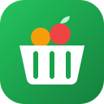

<!-- Improved compatibility of back to top link: See: https://github.com/othneildrew/Best-README-Template/pull/73 -->
<a id="readme-top"></a>
<!--
*** Built from the Best-README-Template.
*** Before submitting, search & replace these placeholders with your own info:
***   YOUR_FULL_NAME, linkedin_username, YOUR_LIVE_URL
-->


<!-- PROJECT SHIELDS -->
[![Contributors][contributors-shield]][contributors-url]
[![Forks][forks-shield]][forks-url]
[![Stargazers][stars-shield]][stars-url]
[![Issues][issues-shield]][issues-url]
[![MIT License][license-shield]][license-url]
[![LinkedIn][linkedin-shield]][linkedin-url]


<!-- PROJECT LOGO -->
<br />
<div align="center">
  <a href="https://github.com/xknjmds/fresh-stock">
    
  </a>

<h3 align="center">FreshStock — Grocery Stock Management System</h3>

  <p align="center">
    A responsive PHP &amp; MySQL web app that helps a convenience store track products, suppliers, stock deliveries, sales and expiry dates — all in one dashboard.
    <br />
    <a href="#usage"><strong>Explore the docs »</strong></a>
    <br />
    <br />
    <a href="https://eljhonbrana.freedev.app/">View Live Demo</a>
    &middot;
    <a href="https://github.com/xknjmds/fresh-stock/issues/new?labels=bug&template=bug-report---.md">Report Bug</a>
    &middot;
    <a href="https://github.com/xknjmds/fresh-stock/issues/new?labels=enhancement&template=feature-request---.md">Request Feature</a>
  </p>
</div>


<!-- TABLE OF CONTENTS -->
<details>
  <summary>Table of Contents</summary>
  <ol>
    <li>
      <a href="#about-the-project">About The Project</a>
      <ul>
        <li><a href="#project-details">Project Details</a></li>
        <li><a href="#features">Features</a></li>
        <li><a href="#built-with">Built With</a></li>
      </ul>
    </li>
    <li>
      <a href="#getting-started">Getting Started</a>
      <ul>
        <li><a href="#prerequisites">Prerequisites</a></li>
        <li><a href="#installation">Installation</a></li>
      </ul>
    </li>
    <li>
      <a href="#usage">Usage</a>
      <ul>
        <li><a href="#modules">Modules</a></li>
        <li><a href="#database-design">Database Design</a></li>
        <li><a href="#project-structure">Project Structure</a></li>
        <li><a href="#deploying-to-infinityfree">Deploying to InfinityFree</a></li>
      </ul>
    </li>
    <li><a href="#roadmap">Roadmap</a></li>
    <li><a href="#contributing">Contributing</a></li>
    <li><a href="#license">License</a></li>
    <li><a href="#contact">Contact</a></li>
    <li><a href="#acknowledgments">Acknowledgments</a></li>
  </ol>
</details>


<!-- ABOUT THE PROJECT -->
## About The Project

[![FreshStock Dashboard Screenshot][product-screenshot]](https://https://eljhonbrana.freedev.app/)

Small convenience stores often track inventory in notebooks or spreadsheets, so items run out unnoticed and perishable goods expire on the shelf. **FreshStock** is a web-based stock management system built for this situation. It lets the store owner:

* keep a clean catalogue of products, categories and suppliers;
* record every **stock in** (delivery), **stock out** (sale or damage) and **count adjustment**, with a full audit trail;
* see at a glance what needs restocking and what is about to expire.

This project demonstrates a responsive Bootstrap 5 front end, full CRUD operations with PHP + MySQL, and deployment on InfinityFree.

### Project Details

| | |
|---|---|
| **Project Type** | Final Project (Individual) |
| **Course** | ITPE3124 — Web System Technologies |
| **Instructor** | Prof. Kenth Joshua Espina |
| **Developer** | El Jhon O. Braña |
| **Program, Year & Section** | BSIT 3A-SD | 
| **Stack** | PHP, MySQL, HTML, CSS, Bootstrap 5 |
| **Hosting** | InfinityFree |

### Features

* **Full CRUD** on Products, Categories, Suppliers and Stock Movements
* **Interactive dashboard:**
  * animated stat counters
  * Chart.js bar chart (stock in vs out over the last 7 days)
  * doughnut chart (units per category)
  * estimated potential profit
* **Low-stock alerts**, based on a per-product reorder level
* **Expiry tracking**, with "expiring in ≤ 30 days" and "expired" alerts
* **Stock In / Out / Adjust**:
  * shows a live preview of the quantity before and after the movement
  * blocks overselling
  * uses database transactions to keep stock and history in sync
* **Search, filters, sorting and pagination** on the product list
* **CSV export** (opens in Excel) and print-friendly product list
* **Live profit / markup calculator** and one-click SKU generator on the product form
* **shadcn/ui-inspired interface** built on Bootstrap 5:
  * zinc neutral palette, Geist font, collapsible sidebar and sticky top navbar
  * data tables with row action menus, segmented status tabs and empty states
* **Command menu**: press <kbd>Ctrl</kbd> + <kbd>K</kbd> to jump to any page or product
* **Dark mode** toggle, remembered per browser, with a smooth cross-fade
* **Animations:**
  * staggered page and card entrances, scroll reveals and fading table rows
  * count-up numbers, animated progress bars and charts
  * sonner-style toasts, scale-in dialogs and dropdowns, sliding tab indicator
  * top loading bar on navigation and loading spinners on buttons
* **Security:**
  * login with hashed passwords
  * prepared statements on every query
  * CSRF tokens on every form
  * all output escaped against XSS
  * deletes accepted by POST only

<p align="right">(<a href="#readme-top">back to top</a>)</p>


### Built With

* [![PHP][PHP]][PHP-url]
* [![MySQL][MySQL]][MySQL-url]
* [![HTML5][HTML5]][HTML5-url]
* [![CSS3][CSS3]][CSS3-url]
* [![Bootstrap][Bootstrap.com]][Bootstrap-url]
* [![JavaScript][JavaScript]][JavaScript-url]
* [![Chart.js][Chartjs]][Chartjs-url]
* [![XAMPP][XAMPP]][XAMPP-url]

<p align="right">(<a href="#readme-top">back to top</a>)</p>


<!-- GETTING STARTED -->
## Getting Started

Follow these steps to run a copy of the project on your own computer.

### Prerequisites

* [XAMPP](https://www.apachefriends.org/) with **PHP 8.0+** and MySQL/MariaDB
* A modern web browser (Chrome, Edge, Firefox)
* [Git](https://git-scm.com/) (optional, for cloning)
* An internet connection: Bootstrap, Bootstrap Icons, Chart.js and Google Fonts load from a CDN

### Installation

1. Clone the repo into XAMPP's `htdocs` folder.
   ```sh
   cd C:\xampp\htdocs
   git clone https://github.com/xknjmds/fresh-stock.git grocery-stock-management-system
   ```
2. Start **Apache** and **MySQL** from the XAMPP Control Panel.
3. Open [http://localhost/phpmyadmin](http://localhost/phpmyadmin) and create a new database named **`grocery_stock`** (collation `utf8mb4_unicode_ci`).
4. Select the new database, open the **Import** tab and import **`database/grocery_stock.sql`**.
5. Check the local credentials in `config/db_connect.php`. The XAMPP defaults are already set:
   ```php
   define('DB_HOST', 'localhost');
   define('DB_USER', 'root');
   define('DB_PASS', '');
   define('DB_NAME', 'grocery_stock');
   ```
6. Visit [http://localhost/grocery-stock-management-system](http://localhost/grocery-stock-management-system) and sign in:

   | Username | Password   |
   |----------|------------|
   | `admin`  | `admin123` |

<p align="right">(<a href="#readme-top">back to top</a>)</p>


<!-- USAGE EXAMPLES -->
## Usage

### Modules

| Page | What you can do | CRUD |
|------|-----------------|------|
| **Dashboard** (`index.php`) | Stats, charts, low-stock and expiring lists, recent activity | Read |
| **Products** (`products.php`, `product_form.php`) | Add, view, search/filter/sort, edit and delete products; export CSV | Create · Read · Update · Delete |
| **Stock In/Out** (`stock.php`) | Record deliveries, sales and count corrections; view and remove history entries | Create · Read · Update (qty) · Delete |
| **Categories** (`categories.php`) | Manage categories in a card grid with per-category stock value | Create · Read · Update · Delete |
| **Suppliers** (`suppliers.php`) | Manage supplier contacts and see how many products each supplies | Create · Read · Update · Delete |

**Typical workflow**
1. Add your **categories** and **suppliers**.
2. Add **products**, setting their price, opening quantity, reorder level and optional expiry date.
3. When a delivery arrives, use **Stock In**. When items are sold or damaged, use **Stock Out**. After a physical count, use **Adjust**.
4. Check the **Dashboard** each day for items that need restocking or are about to expire.

> A category or supplier that still has products cannot be deleted. The database enforces this with foreign keys (`ON DELETE RESTRICT`), and the app shows a friendly message instead.

### Database Design

Five related tables (InnoDB, `utf8mb4`), each with a primary key and suitable data types:

```
users (1) ─────────────< stock_movements >───────────── (1) products
                                                         │      │
                                    categories (1) ──────┘      └────── (1) suppliers
```

| Table | Fields | Relationships |
|-------|--------|---------------|
| `users` | `id` PK, `full_name`, `username` UNIQUE, `password_hash`, `created_at` | — |
| `categories` | `id` PK, `name` UNIQUE, `description`, `created_at` | 1 category → many products |
| `suppliers` | `id` PK, `name`, `contact_person`, `phone`, `email`, `address`, `created_at` | 1 supplier → many products |
| `products` | `id` PK, `sku` UNIQUE, `name`, `category_id` FK, `supplier_id` FK, `unit`, `cost_price` DECIMAL(10,2), `selling_price` DECIMAL(10,2), `quantity` INT, `reorder_level` INT, `expiry_date` DATE, `created_at`, `updated_at` | FK → categories (RESTRICT), FK → suppliers (RESTRICT) |
| `stock_movements` | `id` PK, `product_id` FK, `user_id` FK, `type` ENUM('in','out','adjust'), `quantity`, `remarks`, `created_at` | FK → products (CASCADE), FK → users (SET NULL) |

### Project Structure

```
grocery-stock-management-system/
├── assets/
│   ├── css/style.css          # shadcn-style design tokens, components, dark mode, animations
│   └── js/
│       ├── app.js             # theme, toasts, command menu, delete dialog, counters, filters
│       └── dashboard.js       # Chart.js charts
├── config/
│   └── db_connect.php         # DB credentials (auto-switches local / live)
├── database/
│   └── grocery_stock.sql      # schema + sample data
├── images/                    # logo + README screenshot
├── includes/
│   ├── auth.php               # session, login guard, CSRF helpers
│   ├── functions.php          # shared helpers (escape, flash, badges...)
│   ├── header.php             # <head> + navbar
│   └── footer.php             # scripts + footer
├── index.php                  # dashboard
├── products.php               # product list
├── product_form.php           # add / edit product
├── product_delete.php         # delete product
├── categories.php             # categories CRUD
├── suppliers.php              # suppliers CRUD
├── stock.php                  # stock in / out / adjust + history
├── export.php                 # CSV export
├── login.php / logout.php
├── LICENSE.txt
└── README.md
```

### Deploying to InfinityFree

1. Develop and test the project locally with **XAMPP**. Check that every CRUD operation works.
2. In phpMyAdmin, export the database as an `.sql` file. You can also use the included `database/grocery_stock.sql`.
3. Create an account at [https://www.infinityfree.net](https://www.infinityfree.net).
4. In the **Client Area**, create a new **Hosting Account** and choose a subdomain.
5. Go to **Control Panel → MySQL Databases**, create a new database, then copy its **hostname**, **username**, **password** and **database name**.
6. Edit the **LIVE** block in `config/db_connect.php`:
   ```php
   define('DB_HOST', 'sqlXXX.infinityfree.com');
   define('DB_USER', 'if0_XXXXXXXX');
   define('DB_PASS', 'your_password_here');
   define('DB_NAME', 'if0_XXXXXXXX_grocery');
   ```
   The app uses these values automatically whenever it is not running on `localhost`.
7. Open **File Manager** (or use FTP) and upload the *contents* of the project folder into `htdocs/`.
8. Open InfinityFree's **phpMyAdmin**, select your database and **Import** `database/grocery_stock.sql`. The file has no `CREATE DATABASE` statement, so it imports straight into the existing database.
9. Visit your live link (for example `https://yourfullname.infinityfreeapp.com`). Log in and test every page.
10. Submit the live link and this repository link.

<p align="right">(<a href="#readme-top">back to top</a>)</p>


<!-- ROADMAP -->
## Roadmap

- [x] Product, category and supplier CRUD
- [x] Stock in / out / adjustment with movement history
- [x] Dashboard with charts and alerts
- [x] Low-stock and expiry notifications
- [x] Search, filters, sorting, pagination
- [x] CSV export and print view
- [x] Dark mode and animations
- [ ] Barcode scanning with the device camera
- [ ] Point-of-sale (POS) screen with receipts
- [ ] Multiple user roles (admin / cashier)
    - [ ] Per-user activity reports
- [ ] Automatic purchase orders for low-stock items

See the [open issues](https://github.com/xknjmds/fresh-stock/issues) for a full list of proposed features (and known issues).

<p align="right">(<a href="#readme-top">back to top</a>)</p>


<!-- CONTRIBUTING -->
## Contributing

This is an individual academic project, but suggestions are welcome. If you have an idea that would make it better, please fork the repo and create a pull request, or open an issue with the tag "enhancement".

1. Fork the Project
2. Create your Feature Branch (`git checkout -b feature/AmazingFeature`)
3. Commit your Changes (`git commit -m 'Add some AmazingFeature'`)
4. Push to the Branch (`git push origin feature/AmazingFeature`)
5. Open a Pull Request

<p align="right">(<a href="#readme-top">back to top</a>)</p>

### Top contributors:

<a href="https://github.com/xknjmds/fresh-stock/graphs/contributors">
  
</a>


<!-- LICENSE -->
## License

Distributed under the MIT License. See `LICENSE.txt` for more information.

<p align="right">(<a href="#readme-top">back to top</a>)</p>


<!-- CONTACT -->
## Contact

El Jhon Braña — [LinkedIn](https://www.linkedin.com/in/el-jhon-bra%C3%B1a-73956a339)

Live System: [https://https://eljhonbrana.freedev.app/](https://https://eljhonbrana.freedev.app/)

Project Link: [https://github.com/xknjmds/fresh-stock](https://github.com/xknjmds/fresh-stock)

<p align="right">(<a href="#readme-top">back to top</a>)</p>


<!-- ACKNOWLEDGMENTS -->
## Acknowledgments

* Prof. Kenth Joshua Espina, for the project guidelines and instruction in ITPE3124 — Web System Technologies
* [Bootstrap 5](https://getbootstrap.com)
* [Bootstrap Icons](https://icons.getbootstrap.com)
* [Chart.js](https://www.chartjs.org)
* [shadcn/ui](https://ui.shadcn.com) — design inspiration (colour tokens and component styles)
* [Geist font](https://vercel.com/font) via Google Fonts
* [InfinityFree](https://www.infinityfree.net)
* [Shields.io](https://shields.io)
* [Best-README-Template](https://github.com/othneildrew/Best-README-Template)

<p align="right">(<a href="#readme-top">back to top</a>)</p>


<!-- MARKDOWN LINKS & IMAGES -->
<!-- https://www.markdownguide.org/basic-syntax/#reference-style-links -->
[contributors-shield]: https://img.shields.io/github/contributors/xknjmds/fresh-stock.svg?style=for-the-badge
[contributors-url]: https://github.com/xknjmds/fresh-stock/graphs/contributors
[forks-shield]: https://img.shields.io/github/forks/xknjmds/fresh-stock.svg?style=for-the-badge
[forks-url]: https://github.com/xknjmds/fresh-stock/network/members
[stars-shield]: https://img.shields.io/github/stars/xknjmds/fresh-stock.svg?style=for-the-badge
[stars-url]: https://github.com/xknjmds/fresh-stock/stargazers
[issues-shield]: https://img.shields.io/github/issues/xknjmds/fresh-stock.svg?style=for-the-badge
[issues-url]: https://github.com/xknjmds/fresh-stock/issues
[license-shield]: https://img.shields.io/github/license/xknjmds/fresh-stock.svg?style=for-the-badge
[license-url]: https://github.com/xknjmds/fresh-stock/blob/master/LICENSE.txt
[linkedin-shield]: https://img.shields.io/badge/-LinkedIn-black.svg?style=for-the-badge&logo=linkedin&colorB=555
[linkedin-url]: https://www.linkedin.com/in/el-jhon-bra%C3%B1a-73956a339/
[product-screenshot]: images/screenshot.png
<!-- Shields.io badges. You can a comprehensive list with many more badges at: https://github.com/inttter/md-badges -->
[PHP]: https://img.shields.io/badge/PHP-777BB4?style=for-the-badge&logo=php&logoColor=white
[PHP-url]: https://www.php.net/
[MySQL]: https://img.shields.io/badge/MySQL-4479A1?style=for-the-badge&logo=mysql&logoColor=white
[MySQL-url]: https://www.mysql.com/
[HTML5]: https://img.shields.io/badge/HTML5-E34F26?style=for-the-badge&logo=html5&logoColor=white
[HTML5-url]: https://developer.mozilla.org/en-US/docs/Web/HTML
[CSS3]: https://img.shields.io/badge/CSS3-1572B6?style=for-the-badge&logo=css3&logoColor=white
[CSS3-url]: https://developer.mozilla.org/en-US/docs/Web/CSS
[Bootstrap.com]: https://img.shields.io/badge/Bootstrap-563D7C?style=for-the-badge&logo=bootstrap&logoColor=white
[Bootstrap-url]: https://getbootstrap.com
[JavaScript]: https://img.shields.io/badge/JavaScript-F7DF1E?style=for-the-badge&logo=javascript&logoColor=black
[JavaScript-url]: https://developer.mozilla.org/en-US/docs/Web/JavaScript
[Chartjs]: https://img.shields.io/badge/Chart.js-FF6384?style=for-the-badge&logo=chartdotjs&logoColor=white
[Chartjs-url]: https://www.chartjs.org/
[XAMPP]: https://img.shields.io/badge/XAMPP-FB7A24?style=for-the-badge&logo=xampp&logoColor=white
[XAMPP-url]: https://www.apachefriends.org/
